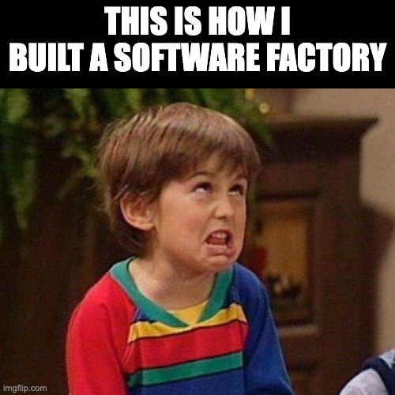
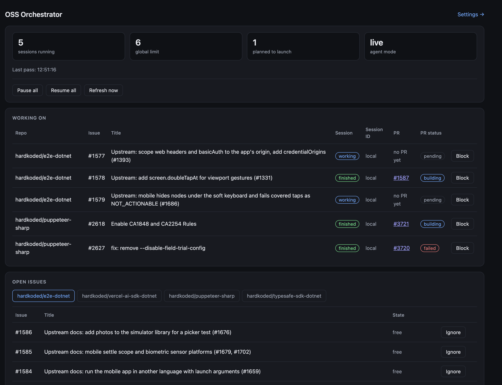

I hope this doesn't sound like a typical "this is how I built my software factory" post with lots of paragraphs and 0 good content.



Building OSS, for me, has two main goals. Not just two, but let's say two: helping the community, and learning some technology.

But these days it is also about learning how to work with agents without losing contact with the code. Because remember, I want to learn.

Working with agents also opened the door to work on many tools. Four repos, right now:

- [Puppeteer Sharp](https://github.com/hardkoded/puppeteer-sharp) is a .NET port of the official Node.js Puppeteer API. Docs: [puppeteersharp.com](https://www.puppeteersharp.com/).
- [E2E .NET](https://github.com/hardkoded/e2e-dotnet) is a community port of [e2e](https://github.com/tester-army/e2e), the agentic end-to-end testing framework. You describe a goal, an agent drives the app, then you check the result with locators. Not an official TesterArmy product. Docs: [hardkoded.com/e2e-dotnet](https://www.hardkoded.com/e2e-dotnet/).
- [Vercel AI SDK for .NET](https://github.com/hardkoded/vercel-ai-sdk-dotnet) is a provider-agnostic C# toolkit to build AI apps and agents on .NET. An unofficial community port of the [Vercel AI SDK](https://github.com/vercel/ai), not a Vercel product. Docs: [hardkoded.com/vercel-ai-sdk-dotnet](https://www.hardkoded.com/vercel-ai-sdk-dotnet/).
- [TypeSafe SDK .NET](https://github.com/hardkoded/typesafe-sdk-dotnet) is a community .NET client for [TypeSafe AI](https://typesafe.ai), a port of their JavaScript SDK. Typed questions, typed answers. Not an official TypeSafe product. Docs: [hardkoded.com/typesafe-sdk-dotnet](https://www.hardkoded.com/typesafe-sdk-dotnet/).

That's a lot of issues. And a lot of Claude sessions.

## "You are now an orchestrator"

Building an orchestrator is not just opening a Claude session and saying "you are now an orchestrator".

I did that. The session ended up forgetting about it.

## The golden rule

> Deterministic tools for deterministic tasks, agentic tools for agentic tasks.

Launching a worker, adding a label, counting sessions, closing a tab. That has to happen the same way every time. An agent is the wrong tool for it.

The agent is the worker inside the issue. The thing that decides when to start it should be boring code.

## A console app and a dashboard

So I built a deterministic orchestrator. A.k.a. a console app written in .NET. And a web dashboard where I can see the progress of the work.

The repo is [hardkoded/oss-orchestrator](https://github.com/hardkoded/oss-orchestrator). Two parts, and they talk through a database.

## Before

What I had was a Herdr mod called orc-panel, on one PC. It read a `repos.json` file and started one Claude Code worker per GitHub issue, each in its own Herdr tab.

Issues were claimed by assigning them to a GitHub user. So the assignee looked like the owner even when nothing was running.

There was no shared view. To see what was running, if a PR was green, or if an issue was stuck, I had to read the terminals.

Pause, the session limit, and "ignore this issue" lived in that panel, on that one machine.

## The pieces

**The agent** is a .NET console app on the PC. Every 120 seconds it applies queued commands, reads GitHub and Herdr, plans launches, starts workers, and writes the state back. Refresh now wakes it within about 5 seconds for a full pass.

**Cosmos DB, free tier**, is the source of truth. It holds the config, a command queue, and the latest state.

**The dashboard** is ASP.NET Core Razor Pages on Azure App Service, free tier. Sign-in is Microsoft Entra ID, and only one account is allowed.

The dashboard never talks to GitHub. Actions go into the command queue, and the agent applies them. The agent is the only one with GitHub write access, through `gh` and my own login.

## The dashboard



Four cards: sessions running, the global limit, how many are planned to launch, and the agent mode (live or dry run). That shot is 5 running, limit 6, 1 planned, live.

Working on lists each session's issue and title, the status, the session id, the PR, the PR status, and a Block button. The session id says `local`, because every launch is still local.

Open issues is a tab per repo, with Ignore, Unblock, and a status tag.

Pause all, Resume all, and Refresh now sit at the top.

Settings is small. The global limit goes from 1 to 20. Each repo can be paused, and auto-launch can be on or off.

The status colors, so I don't have to think about them:

- `working` and `building` are blue
- `needs your answer` is amber
- `finished`, `ready`, and `merged` are green
- `failed` and `conflicted` are red
- `pending`, `idle`, and `closed` are gray

## Labels, not assignees

The agent adds `in-progress` when it starts a worker. It removes the label when the PR merges or closes, or when I block the issue.

`blocked` means the issue is shown, but never taken. Unblock removes that label.

Labels replaced assignees. No person shows up as the owner of an issue the agent is working on.

## Block

Blocking an open session does three things, in this order:

1. It adds `blocked` to the GitHub issue. The issue stays open.
2. It closes that session's Herdr tab, which releases the worker.
3. It removes `in-progress`.

If the label can't be added, the session keeps running. The dashboard asks for confirmation first.

## Detecting a question

Herdr reports a worker that is waiting for an answer as "idle" or "done". Same words it uses for a finished one.

So the agent reads the worker's terminal. It looks for a line that starts with `QUESTION:`, or a "waiting for your answer" phrase. When it finds one, the session shows *needs your answer*.

**This is a text match, so it can be wrong.** The worker brief asks for the `QUESTION:` prefix. Workers don't always use it.

## How it is wired

```text
Browser (me)
   │  Entra ID sign-in
   ▼
Azure App Service: dashboard (Razor Pages, free tier)
   │  reads state, writes commands
   ▼
Cosmos DB (free tier): config · commands · state
   ▲  reads config and commands, writes state
   │
Local agent (PC, every 120 s)
   ├── gh CLI ──── GitHub: issues, PRs, labels (my login)
   ├── herdr-app / hc ── Herdr tabs: one Claude Code worker per issue
   └── (planned) claude --cloud ── Claude cloud sessions
```

## Problems I hit

A second worker almost landed on the same issue. Labeling failed after the launch, and the launch wasn't recorded, so the next pass thought the issue was free. The fix was to record the launch first.

Nothing launched, even with free slots. Tabs for closed issues were counting against the limit. Now only the listed sessions count.

Merged work showed "no PR yet". The lookup only checked open PRs. It now falls back to the newest merged or closed PR.

Old issues kept `in-progress`. Cleanup only looked at the 30 issues on the dashboard. The agent now queries every issue that has the label.

And Azure returned 500s. The zip had backslash paths, so Linux couldn't load the app. `Compress-Archive` did that. Zipping with `tar` fixed it.

## What's next

Cloud sessions. `claude --cloud "<description>"` creates one. It prints a `Created cloud session` line, a `View: https://claude.ai/code/session_…` link, and a resume command. It refuses to run without a terminal, so the agent runs it inside Herdr's `hc` and reads the link back.

One real test session was created on [vercel-ai-sdk-dotnet](https://github.com/hardkoded/vercel-ai-sdk-dotnet), with the description `"#2333"`. Whether it could read the repository is still being checked.

The launch mode is already a setting, cloud or local. The choice is stored. The agent still launches local sessions, and the Session ID column says `local`.

Other gaps I already know about:

- Herdr tabs for closed issues stay open. Nothing closes them.
- An issue closed without a merged PR can be picked up again.
- I'm still testing Block on a real session.
- After one restart, a pass took about three minutes. Not diagnosed.

## Final words

The agents can take the issues. The orchestrator stays a console app, a free-tier database, and a page I can actually look at.

I still want to read the code. That's the part I don't want to hand over.

Don't stop coding!
